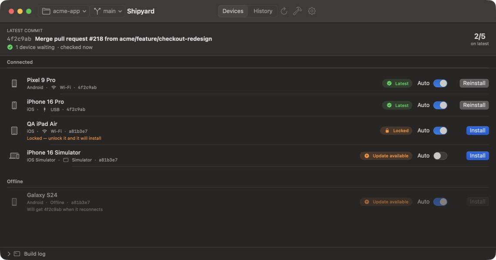
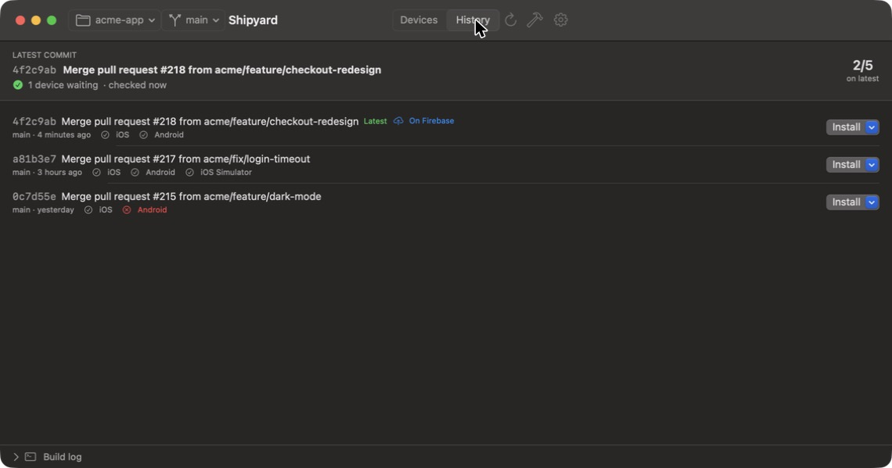

# Shipyard

A Mac menu-bar app that watches a Git branch of your Flutter project and, every time something is merged, builds the app and installs it on every phone, tablet and simulator connected to your Mac — over USB or Wi-Fi.

Merge a pull request, pick up your phone, and the new build is already there.



## What it does

- **Watches a branch.** Checks `origin/<branch>` every 60 seconds (configurable). A new commit starts a build.
- **Builds once, installs everywhere.** One build per platform per commit, pushed to every connected device.
- **Physical devices and simulators.** iPhones and iPads, Android phones, iOS simulators and Android emulators. Each row shows whether the device is on USB, Wi-Fi or is a simulator.
- **A queue for devices that aren't ready.** A locked or offline device gets the build as soon as it is unlocked or reconnects.
- **Per-device control.** An Auto switch per device, and an Install button for the ones you update by hand.
- **Status at a glance.** Latest, Update available, Locked, Failed or Not installed on every device, plus an "N of M on latest" count.
- **Build history with rollback.** The last five builds are kept, so you can put an older one back on a device.
- **Several projects.** Switch project and branch from the toolbar. Each project has its own devices and settings.
- **Remote testers.** Optionally upload every build to Firebase App Distribution for devices that are not on your network.
- **Notifications** when devices are updated or a build fails.
- **Leaves your checkout alone.** Builds happen in a separate Git worktree under `~/.shipyard/`.



## Requirements

- macOS 14 or later
- [Flutter](https://docs.flutter.dev/get-started/install) on your `PATH`
- Xcode, for iOS devices and simulators
- Android SDK platform tools (`adb`), for Android devices
- A Flutter project whose Git remote is named `origin`

## Install

1. Download `Shipyard.zip` from the [latest release](../../releases/latest) and unzip it.
2. Move `Shipyard.app` to your Applications folder.
3. The app is not notarized by Apple, so macOS blocks the first launch. Either right-click the app and choose **Open**, or run:

   ```bash
   xattr -dr com.apple.quarantine /Applications/Shipyard.app
   ```

## Getting started

1. Open Shipyard and choose your Flutter project folder.
2. Pick the branch to follow in the toolbar (default `main`).
3. Connect your devices. They appear in the list within a minute; the refresh button checks immediately.

Each device needs a one-time setup before it can receive builds:

| Device | One-time setup |
|---|---|
| iPhone / iPad | Connect by USB once and trust the Mac, turn on Developer Mode, and register the device with your Apple developer team. For Wi-Fi, tick "Connect via network" in Xcode's Devices window. |
| Android | Turn on USB debugging, or Wireless debugging (Android 11+) and pair once with `adb pair`. |
| Simulator / emulator | Just start it. Simulators have Auto off by default so a merge doesn't replace an app you are debugging. |

## Settings

Open Settings with the gear button. These apply to the selected project:

| Setting | What it is for |
|---|---|
| Extra files to copy | Git-ignored files the build needs (fonts, local config), separated by spaces. They are copied from your project folder into the build copy. |
| Flutter build arguments | Passed to every `flutter build`, for example `--dart-define-from-file=config/local.json`. |
| Apple team ID | Only needed when the Xcode project has no development team set. |
| Remote testers | Firebase app IDs and tester groups. See below. |

## Remote testers (optional)

Direct installs only reach devices on the same network as your Mac. For anyone elsewhere, Shipyard can upload each new build to [Firebase App Distribution](https://firebase.google.com/docs/app-distribution):

1. Install the Firebase CLI (`brew install firebase-cli`) and run `firebase login`.
2. In the Firebase console, open App Distribution for your project and create a tester group.
3. In Shipyard's Settings, fill in the Firebase app ID and the group name.

Every new build is then uploaded and the group is notified. iOS uploads use the development-signed build, so they install only on devices registered in your Apple developer account.

## Good to know

- Builds are release builds for physical devices, because iOS debug builds will not launch from the home screen. Simulators get a debug build.
- Installs use `devicectl`, `simctl` and `adb install -r`, which keep the app's data on the device.
- Rolling a device back to an older build turns its Auto switch off, so the next check does not undo it.
- Kept builds live in `~/.shipyard/<project>/builds/` and can take a few hundred MB each.
- iOS apps can only be built on a Mac, and Shipyard itself is Mac-only.

## Build from source

```bash
git clone https://github.com/Rohitha97/shipyard.git
cd shipyard
./build-app.sh
open Shipyard.app
```

This needs Xcode's command-line tools. `./build-app.sh` also runs a small self-check.

To look around without a project or devices, start it with sample data:

```bash
open Shipyard.app --args --demo
```

## Command-line version

`shipyard.sh` is the original single-file script: it watches one branch and installs on every connected physical device, with no UI.

```bash
./shipyard.sh /path/to/flutter/project [branch]
```

Don't run it while the app is open on the same project; they share a build folder.
